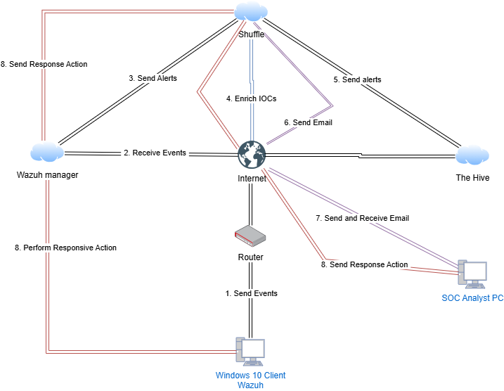

# Home SOC Automation Lab: Wazuh, TheHive & Shuffle

## Overview
A home SOC pipeline that detects endpoint activity with Wazuh, enriches
indicators with Shuffle, manages cases in TheHive, and automates response.
